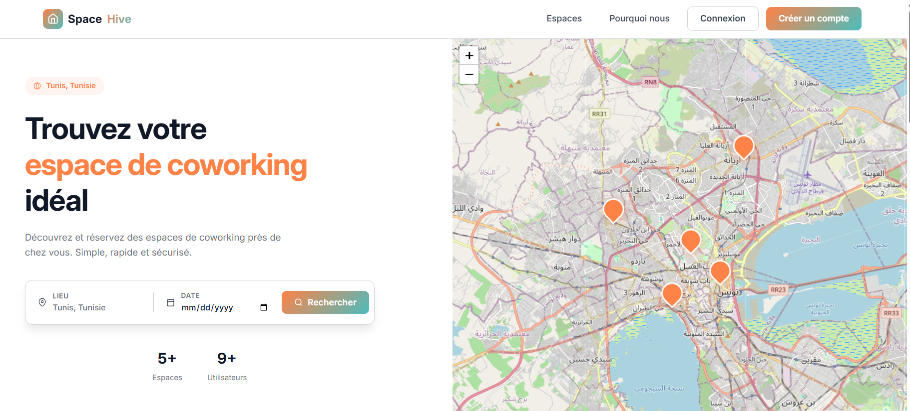
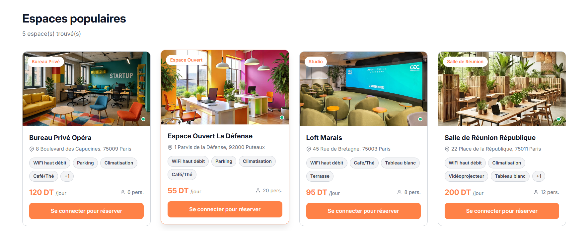
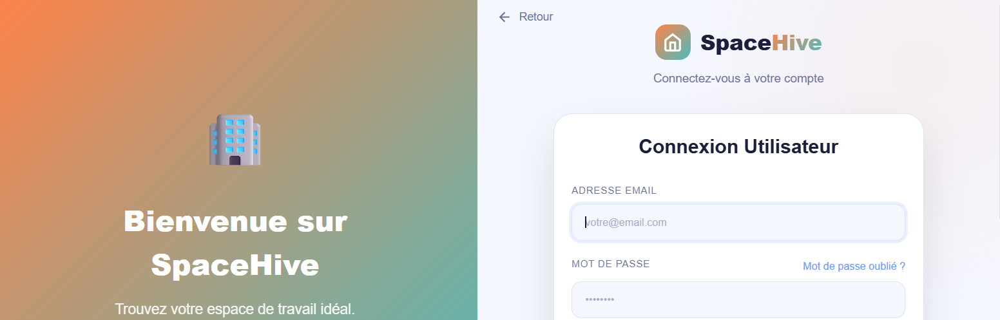
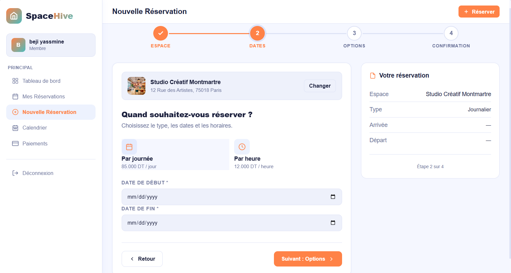
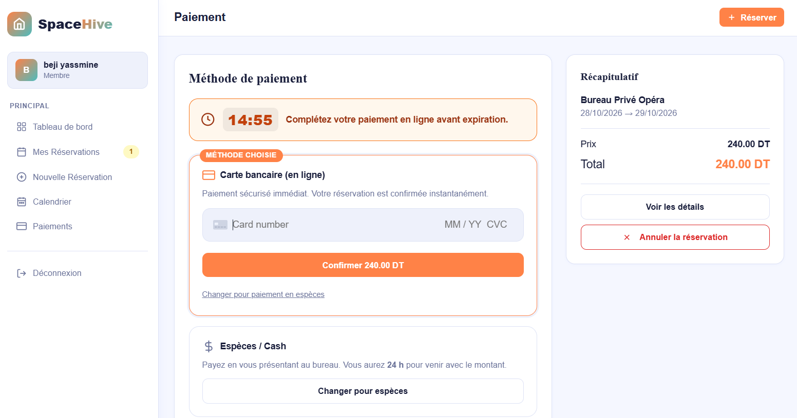

# 🏢 CoWork – Plateforme de réservation d'espaces de coworking

Application web de gestion et de réservation d'espaces de coworking, développée avec **Laravel** (PHP), **MySQL/MariaDB** et **CSS**, et exécutée en local avec **XAMPP**.

Les utilisateurs peuvent consulter les espaces disponibles, réserver à l'heure ou à la journée, payer (Stripe ou espèces), utiliser des codes promo et laisser des avis. Un administrateur gère les espaces, les réservations et les codes promo.

---

## 📑 Sommaire

1. [Fonctionnalités](#-fonctionnalités)
2. [Technologies utilisées](#-technologies-utilisées)
3. [Prérequis](#-prérequis)
4. [Installation](#-installation-avec-xampp)
5. [Base de données](#-base-de-données)
6. [Comptes de démonstration](#-comptes-de-démonstration)
7. [Structure du projet](#-structure-du-projet)
8. [Règles métier](#-règles-métier)
9. [Captures d&#39;écran](#-captures-décran)
10. [Auteur](#-auteur)

---

## ✨ Fonctionnalités

### 👤 Utilisateur

- Inscription, connexion et gestion du profil
- Consultation de la liste des espaces (type, prix, capacité, équipements, photo)
- Réservation **à l'heure** ou **à la journée**
- Application d'un **code promo** (pourcentage ou montant fixe)
- Paiement par **Stripe** (carte) ou **espèces**
- Changement de méthode de paiement (nombre de changements limité)
- Annulation d'une réservation
- Code de confirmation unique pour chaque réservation (ex. `CW-XXXXXXXX`)
- Dépôt d'un **avis** (note de 1 à 5 + commentaire) sur un espace réservé

### 🛠️ Administrateur

- Ajout, modification et suppression d'espaces (image, tarifs, équipements, disponibilité)
- Gestion des réservations et des paiements
- Création et suivi des codes promo (expiration, usage max, montant minimum)
- Gestion des utilisateurs

### ⚙️ Automatisations

- **Expiration automatique** des réservations non payées (champ `expires_at`)
- Statuts de réservation : `pending`, `confirmed`, `expired`, `cancelled`
- Statuts de paiement : `pending`, `paid`, `failed`

---

## 🧰 Technologies utilisées

| Catégorie       | Technologie                             |
| ---------------- | --------------------------------------- |
| Back-end         | PHP 8.2, Laravel                        |
| Front-end        | Blade, HTML5, CSS3                      |
| Base de données | MariaDB 10.4 / MySQL (phpMyAdmin 5.2.1) |
| Serveur local    | XAMPP (Apache + MySQL)                  |
| Paiement         | Stripe (mode test / démo)              |
| Dépendances     | Composer                                |

---

## 📋 Prérequis

- [XAMPP](https://www.apachefriends.org/) avec **PHP 8.2** ou supérieur
- [Composer](https://getcomposer.org/)
- [Node.js et npm](https://nodejs.org/) (uniquement si le projet utilise Vite / npm)
- Git (optionnel)

---

## 🚀 Installation avec XAMPP

### 1. Récupérer le projet

Extraire l'archive `coworking.rar` dans le dossier de XAMPP :

```
C:\xampp\htdocs\coworking
```

### 2. Démarrer les services

Ouvrir le **XAMPP Control Panel** et démarrer **Apache** et **MySQL**.

### 3. Installer les dépendances

```bash
cd C:\xampp\htdocs\coworking
composer install
npm install        # si nécessaire
```

### 4. Configurer l'environnement

```bash
copy .env.example .env
php artisan key:generate
```

Modifier le fichier `.env` :

```env
APP_NAME=CoWork
APP_URL=http://localhost:8000

DB_CONNECTION=mysql
DB_HOST=127.0.0.1
DB_PORT=3306
DB_DATABASE=coworking
DB_USERNAME=root
DB_PASSWORD=

# Stripe (clés de test)
STRIPE_KEY=<votre_cle_publique>
STRIPE_SECRET=<votre_cle_secrete>
```

### 5. Créer la base de données

**Option A – Importer le dump SQL (recommandé, données de démo incluses)**

1. Ouvrir `http://localhost/phpmyadmin`
2. Créer une base nommée `coworking` (interclassement `utf8mb4_unicode_ci`)
3. Onglet **Importer** → choisir `coworking.sql` → **Exécuter**

**Option B – Via les migrations Laravel**

```bash
php artisan migrate --seed
```

### 6. Lier le dossier de stockage (images des espaces)

```bash
php artisan storage:link
```

### 7. Lancer l'application

```bash
php artisan serve
```

Puis ouvrir 👉 **http://localhost:8000**

> Il est aussi possible d'y accéder via Apache : `http://localhost/coworking/public`

---

## 🗄️ Base de données

Nom de la base : **`coworking`**

| Table                | Description                                                                |
| -------------------- | -------------------------------------------------------------------------- |
| `utilisateurs`     | Comptes (rôle `user` ou `admin`)                                      |
| `espace_coworking` | Espaces : tarifs heure/jour, capacité, équipements (JSON), type, image   |
| `reservations`     | Réservations, dates, horaires, statut, prix, remise, code de confirmation |
| `paiements`        | Paiements liés aux réservations (Stripe / espèces)                      |
| `code_promos`      | Codes de réduction (`percent` ou `fixed`)                             |
| `avis`             | Notes et commentaires (1 avis par utilisateur et par espace)               |
| `migrations`       | Historique des migrations Laravel                                          |

### Relations principales

```
utilisateurs 1 ──< reservations >── 1 espace_coworking
reservations 1 ──< paiements
reservations >── 0..1 code_promos
utilisateurs 1 ──< avis >── 1 espace_coworking
avis >── 1 reservations
```

### Types d'espaces

`bureau_prive` · `espace_ouvert` · `salle_reunion` · `studio`

### Codes promo de démonstration

| Code          | Type        | Valeur | Remarques                   |
| ------------- | ----------- | ------ | --------------------------- |
| `WELCOME10` | pourcentage | 10 %   | valable jusqu'au 09/05/2027 |
| `SUMMER20`  | pourcentage | 20 %   | 100 utilisations max        |
| `FLAT50`    | fixe        | 50 €  | commande minimum 200 €     |
| `VIP30`     | pourcentage | 30 %   | 20 utilisations max         |

---

## 🔑 Comptes de démonstration

| Rôle          | Email                  | Mot de passe        |
| -------------- | ---------------------- | ------------------- |
| Administrateur | `admin@cowork.com`   | `<à compléter>` |
| Utilisateur    | `sophie@exemple.com` | `<à compléter>` |

> ⚠️ Les mots de passe sont chiffrés (bcrypt) dans la base. Pensez à les changer avant toute mise en production.

---

## 📁 Structure du projet

```
coworking/
├── app/
│   ├── Http/Controllers/     # Contrôleurs (réservations, espaces, paiements, avis…)
│   ├── Models/               # Modèles Eloquent
│   └── Console/              # Commandes planifiées (expiration des réservations)
├── database/
│   ├── migrations/           # Structure de la base de données
│   └── seeders/              # Données de démonstration
├── public/                   # Point d'entrée, CSS, JS, images
├── resources/
│   └── views/                # Vues Blade
├── routes/
│   └── web.php               # Routes de l'application
├── storage/app/public/spaces # Images des espaces
├── .env.example
├── composer.json
└── README.md
```

> 📌 Adaptez cette arborescence à celle de votre projet réel.

---

## 📐 Règles métier

- Une réservation non payée **expire** après un délai défini (`expires_at`).
- Le prix final = `prix_total` − `remise_montant` (code promo).
- Un code promo est valide s'il est **actif**, **non expiré**, sous son **usage max** et si le **montant minimum** de commande est atteint.
- Un utilisateur ne peut laisser qu'**un seul avis par espace**, rattaché à l'une de ses réservations.
- Le changement de méthode de paiement est limité (`payment_switch_count`).
- Chaque réservation reçoit un **code de confirmation unique**.

---

## 🖼️ Captures d'écran











| Accueil           | Détail d'un espace | Dashboard admin    |
| ----------------- | ------------------- | ------------------ |
| `docs/home.png` | `docs/space.png`  | `docs/admin.png` |

---

## 👨‍💻 Auteur

Projet réalisé par  dans le cadre de **<formation / module / établissement>**.

📧 Contact : `<daboussichames@gmail.com>`

---

## 📄 Licence

Projet à but pédagogique – © 2026
=====================================

# coworking
